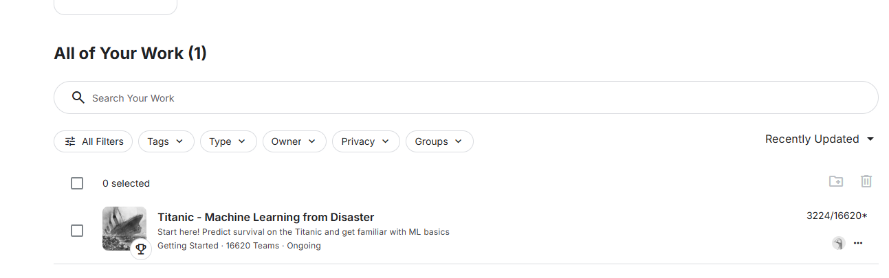

# Project_Machine_Learning
# Data Science Portfolio | Yacine Rouina

**MSc in Engineering (Diplôme d'Ingénieur) @ Centrale Lyon**
*Looking for a Data Science Internship (Starting March 2026)*

## 🚀 Key Projects

### 🚢 Titanic Survival Prediction (Top 5% on Kaggle)
* **Goal:** Binary classification of passenger survival using Ensemble Learning.
* **Tech:** Python, Scikit-Learn, Random Forest and SVM.
* **Highlights:**
    * Built robust preprocessing pipelines using `ColumnTransformer` to prevent data leakage.
    * Engineered features (Title extraction, Family size) to improve signal.
    * **Result:** Top 19% on Kaggle Leaderboard (Accuracy: 83.28%)
  

### 🏠 Housing Prices & Applied ML (In Progress)
* Advanced regression techniques (XGBoost, Stacking) to predict property values.
* Implementation of algorithms from *Hands-On Machine Learning* (A. Géron).

## 🛠 Technical Skills

* **Data Science:** Python (Pandas, NumPy, Scikit-Learn, PyTorch), SQL, MATLAB.
* **Dev & Tools:** C++, Git/GitLab, Linux, LaTeX.
* **Mathematics:** Stochastic Processes, Statistics, Optimization.
